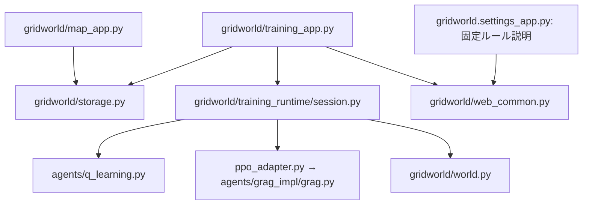

# AI実行環境仕様書

版: 1.4  
更新日: 2026-10-14  
対象: 本プロジェクトの障害物付き2次元グリッドワールド

> 2026-11-09: 現在のGRAGは「A Single Goal Is All You Need」の学習則を離散迷路へ適用したSGCRLです。
> 本書のGRAG向けPPO・言語目標の記述は旧実装の参考情報です。
> 現行の入力・損失・設定・保存形式は [GRAG仕様](agents/grag_impl/README.md) を参照してください。

## 1. 目的と適用範囲

本書は、AIを実行・学習・評価するための環境、ファイル構成、依存関係、エージェントのインターフェース、実行手順、入出力データを定義する。独自AIの公開入口 `agents/grag.py` と実装先 `agents/grag_impl/` を利用する際の参照資料とする。

記載内容は作成日時点のPython実装に基づく。現在提供される機能と、独自AIの接続に追加実装が必要な箇所を区別する。

## 2. 動作条件と起動方法

- Python 3.10以降。環境・Webアプリ・Q学習はPython標準ライブラリで動作する。PPOエージェントとGRAGのニューラルPPOには追加でPyTorch 2.11以降が必要（第13節）。
- マップ作成、環境ルール確認、AI学習の3つのWebアプリを、それぞれ別プロセスで起動する。
- 各サーバーは `127.0.0.1` に接続を限定する。

| 起動コマンド | URL | 用途 |
|---|---|---|
| `python -m gridworld.map_app` | `http://127.0.0.1:5001` | マップ作成・保存 |
| `python -m gridworld.settings_app` | `http://127.0.0.1:5002` | 環境のルールの確認 |
| `python -m gridworld.training_app` | `http://127.0.0.1:5003` | ライブ学習・高速学習・進捗確認 |

各コマンドはプロジェクトのルートフォルダーで実行する。`python` が利用できない場合は、使用するPython実行ファイルのパスを指定する。

3アプリは保存ファイルを介して連携する。学習アプリの起動に他の2アプリの稼働は必要ない。画面からの実行には保存済みマップが必要で、設定ファイルが存在しない場合は標準設定を使う。

## 3. ファイルの役割

### 3.1 Pythonモジュール

依存先は、プロジェクト内で直接importしているモジュールを示す。

| ファイル | 責務 | 依存先 |
|---|---|---|
| [world.py](gridworld/world.py) | 状態、観測、移動、衝突・ゴール判定 | `storage` |
| [ppo_agent.py](agents/ppo_agent.py) | 独立した `PPOAgent` の公開入口 | `agents.ppo_agent_impl.agent` |
| [ppo_agent_impl/agent.py](agents/ppo_agent_impl/agent.py) | GRAGからコピーしたPPO本体。GRAGを継承しない | `ppo_checkpoint`、`agents.ppo_agent_impl.goals`、`torch` |
| [ppo_agent_impl/goals.py](agents/ppo_agent_impl/goals.py) | コピーした目標取得・判定ヘルパー | プロジェクト内依存なし |
| [grag.py](agents/grag.py) | 独自AIの `GRAG` の公開入口 | `agents.grag_impl.grag` |
| [grag_interface.py](agents/grag_impl/grag_interface.py) | 環境に依存しないAIインターフェースのひな形 | プロジェクト内依存なし |
| [grag_impl/grag.py](agents/grag_impl/grag.py) | `GRAG` の実装。目標取得・達成判定、ニューラルPPOの行動選択・確率取得・学習・保存 | `ppo_checkpoint`、`agents.grag_impl.goals`、`agents.grag_impl.networks`、`torch`（行動選択・学習時に読み込み） |
| [grag_impl/networks.py](agents/grag_impl/networks.py) | CleanRL型Actor-Critic。入力次元・行動数・隠れ層幅を受け取る | `torch` |
| [grag_impl/goals.py](agents/grag_impl/goals.py) | 自然言語の目標文と判定用座標、達成判定 | プロジェクト内依存なし |
| [ppo_checkpoint.py](agents/ppo_checkpoint.py) | AI側のPPOチェックポイント保存・復元 | `dataclasses` |
| [q_learning.py](agents/q_learning.py) | Q表、行動選択、Q値更新、探索率減衰 | プロジェクト内依存なし |
| [training.py](gridworld/training.py) | 従来のスクリプト用学習・集計・最終方策再生 | `q_learning`、`world` |
| [training_runtime/session.py](gridworld/training_runtime/session.py) | 同じ学習器を1行動ずつ進め、集計・途中復元を管理 | `q_learning`、`world` |
| [training_runtime/ppo_adapter.py](gridworld/training_runtime/ppo_adapter.py) | 学習画面用のPPOエージェント名 | `grag`、`ppo_agent` |
| [parallel_training.py](gridworld/parallel_training.py) | 複数プロセスによるQ学習とQ表の統合 | `q_learning`、`storage`、`training` |
| [training_app.py](gridworld/training_app.py) | ライブ学習・操作・保存・配信 | `gridworld/training_runtime`、`storage`、`web_common` |
| [map_app.py](gridworld/map_app.py) | マップ一覧・取得・保存・アップロード・ダウンロードAPI | `storage`、`web_common` |
| [settings_app.py](gridworld/settings_app.py) | 固定の環境ルールの説明API | `web_common` |
| [storage.py](gridworld/storage.py) | マップ・設定の検証、標準設定、保存先、JSON読み書き | プロジェクト内依存なし |
| [web_common.py](gridworld/web_common.py) | HTTPサーバー、HTML・CSS配信、JSON応答、アップロード解析 | プロジェクト内依存なし |
| [create_maze_map.py](gridworld/create_maze_map.py) | 固定シードの20×20迷路生成、最短距離確認、保存 | `storage` |
| [test_app.py](gridworld/tests/test_app.py) | 環境・学習・並列処理・Web APIのテスト | `storage`、`parallel_training`、`settings_app`、`training_app`、`map_app`、`training`、`q_learning`、`world` |

### 3.2 画面・文書・実行補助ファイル

| ファイル・フォルダー | 役割 |
|---|---|
| [templates/map.html](gridworld/templates/map.html) | マップ編集画面。内部のJavaScriptからマップAPIを呼ぶ |
| [templates/settings.html](gridworld/templates/settings.html) | 固定の環境ルールを説明する読み取り専用画面 |
| [templates/training.html](gridworld/templates/training.html) | 進捗、学習曲線、ヒートマップ、アニメーションの表示 |
| [training_runtime/training.js](gridworld/training_runtime/training.js) | 観察・高速学習の操作とライブ描画 |
| [training_runtime/training.css](gridworld/training_runtime/training.css) | 学習画面専用の配置・表示 |
| [static/style.css](gridworld/static/style.css) | 3画面で共通のスタイル |
| [README.md](README.md) | 起動方法と概要 |
| [AI_RUNTIME_SPEC.md](AI_RUNTIME_SPEC.md) | AI実行環境の詳細仕様（本書） |
| [.gitignore](.gitignore) | `venv/`、`__pycache__/`、`*.pyc`、`data/` をGit管理から除外 |
| `venv/` | Python仮想環境 |
| `__pycache__/` | Pythonが自動生成するキャッシュ |

保存データの役割は第9節で定義する。

## 4. 依存関係とデータ連携

次の図は主要な呼び出し・利用関係を示す。直接の依存先は第3節の表を参照する。



マップ作成アプリは `data/maps/` に、学習アプリは `data/training_settings.json` に保存する。AI学習アプリは保存マップと学習設定を読み、選択したマップを `data/gridworld.world.json` にコピーして実行する。計算には読み込んだマップの辞書を渡すため、環境が毎ステップ `gridworld.world.json` を読み直すことはない。

## 5. グリッドワールドの仕様

### 5.1 マップと座標

マップはJSONオブジェクトで表す。座標は0始まりの `[行, 列]` で、左上を `[0, 0]` とする。

| キー | 型 | 制約 |
|---|---|---|
| `name` | 文字列 | 前後の空白を除いて1〜100文字 |
| `rows` | 整数 | 2〜50 |
| `cols` | 整数 | 2〜50 |
| `start` | 整数2要素の配列 | 範囲内の開始位置 |
| `goal` | 整数2要素の配列 | 範囲内の目標位置。開始位置とは異なる |
| `obstacles` | 座標配列の配列 | 範囲内、重複なし、開始・目標位置との重なりなし。省略時は空配列 |

```json
{
  "name": "例",
  "rows": 3,
  "cols": 3,
  "start": [0, 0],
  "goal": [2, 2],
  "obstacles": [[1, 1]]
}
```

形式・範囲・重なりを検証する。ゴールに到達できる経路が存在するかは検証しない。

### 5.2 観測と行動

観測 `observation` は、マップの6項目と `position: [行, 列]` を含む辞書である。AIにはマップ全体と現在位置が渡される。観測には報酬、衝突フラグ、残り行動回数、試行番号は含まれない。エージェントは受け取った観測を変更せず、内部状態を自身で管理する。

| 行動文字列 | 行の変化 | 列の変化 |
|---|---:|---:|
| `up` | -1 | 0 |
| `down` | +1 | 0 |
| `left` | 0 | -1 |
| `right` | 0 | +1 |

1行動で上下左右の隣接マスに移動する。障害物または範囲外への移動では位置を変更せず、`collision=True` を返す。衝突も1行動として数える。斜め移動・待機を表す行動は定義されていない。

### 5.3 環境API

| API | 戻り値・動作 |
|---|---|
| `GridWorld(map_data: dict)` | マップを検証し、開始位置と `done=False` で初期化 |
| `observation() -> dict` | 現在の観測 |
| `reset() -> dict` | 開始位置へ戻し、`done=False` にして観測を返す |
| `step(action: str) -> tuple[dict, bool, bool]` | 状態を更新し、`(次の観測, ゴール到達, 衝突)` を返す |
| `transition(position: tuple[int, int], action: str)` | 内部状態を変更せず、`(次の位置, ゴール到達, 衝突)` を返す |

ゴール到達後の `step()` は `RuntimeError`、不明な行動は `ValueError` になる。最大行動回数は環境自身では管理せず、実行処理側が管理する。

### 5.4 報酬と試行終了

`gridworld/world.py` は報酬計算や学習を行わない。`TrainingSession.step()` と従来の `gridworld/training.py` は、各行動後にゴールへ到達した場合の報酬を1、それ以外を0とする。衝突ペナルティや移動コストはない。

試行は、ゴール到達または `max_steps` 回の行動で終了する。最大回数に達しても、ゴール未到達なら `GridWorld.done` はFalseのままである。最大回数による終了はゴール到達と区別する。

## 6. 学習アプリの設定

環境のルールは固定で、設定画面は読み取り専用とする。高速学習する試行数、1試行の最大行動回数、シード、学習パラメータは学習画面が管理する。

| 項目・キー | 標準値 | 制約・適用時期 |
|---|---:|---|
| 高速学習回数 `episodes` | 100 | 整数1〜1,000,000。操作ごとに指定 |
| 最大行動回数 `max_steps` | 200 | 整数1〜1,000,000。変更は次の試行から |
| Q学習率 `learning_rate` | 0.1 | 0〜1。新しい学習で適用 |
| 割引率 `discount_factor` | 0.95 | 0〜1。新しい学習で適用 |
| 初期探索率 `epsilon` | 1.0 | 0〜1。新しい学習で適用 |
| 探索率倍率 `epsilon_decay` | 0.995 | 0〜1。試行終了ごとに減衰 |
| 探索率下限 `min_epsilon` | 0.05 | 0〜初期探索率。新しい学習で適用 |
| シード `seed` | 42 | 整数0〜2^32−1または `null`。新しい学習で適用 |
| PPO学習率 `ppo_learning_rate` | 0.0003 | 正の有限値。新しい学習で適用 |
| PPO隠れ層幅 `ppo_hidden_size` | 64 | 正の整数。新しい学習で適用 |
| 観察間隔 `step_delay_ms` | 160 | 整数20〜2,000ミリ秒。観察中にも変更可 |

共通設定は `validate_settings()`、PPO固有設定は各PPOエージェントが検証する。新しい学習の設定は `data/training_settings.json` に保存する。これがない場合は旧 `data/settings.json` を読み込む。旧ファイルの試行数は画面の高速学習回数へ引き継がない。

スクリプト互換用の `DEFAULT_SETTINGS["episodes"]` は1000のままとする。Web APIではトップレベルの `episodes` が優先され、`training_settings` 内の試行数は受け付けない。続行時は保存した学習パラメータを引き継ぐ。最大行動回数の変更には `limit` 操作を使う。

## 7. エージェントのインターフェース

```python
class Agent:
    def __init__(self, settings: dict): ...
    def choose_action(self, observation: dict, greedy: bool = False) -> str: ...
    def learn(self, observation: dict, action: str, reward: float,
              next_observation: dict, reached_goal: bool) -> None: ...
    def end_episode(self) -> None: ...
    def export(self) -> dict: ...
```

- 全試行で同じエージェントを使う。試行ごとにモデルを作り直さない。
- `choose_action()` は `up`, `down`, `left`, `right` のいずれかを返す。
- 各行動の後、ゴール到達時も `learn()` を呼ぶ。行動前後の観測は変更しない。
- ゴール到達と行動上限の両方で `end_episode()` を呼ぶ。
- `reached_goal` はゴール到達だけを表す。衝突、残り行動数、終了理由の専用引数はない。
- `export()` はモデル・設定等のJSONにできる辞書を返す。
- `greedy=True` は明示的な方策評価用で、探索乱数・学習バッファーを変更しない。
- 行動選択・学習更新の途中を強制中断する機構はない。停止は1行動の処理後に反映する。

再起動後も続行するクラスは、JSONにできる `checkpoint()` と、それを復元する `load_checkpoint(state)` を追加する。Q学習・GRAG・PPOAgentの本体が公開メソッドで対応する。PPOの保存処理はAI側の `agents/ppo_checkpoint.py` に置き、実行層はAIの内部属性を参照しない。評価用コピーには `evaluation_copy()`、または `from_export()` を使える。どちらもない場合は共通層が `deepcopy()` を使う。

AIは環境・Webをimportせず、観測辞書を入力として受け取る。行動確率を表示するAIは任意の `action_probabilities(observation)` を公開し、4方向の確率（各0〜1、合計1）を返す。入力・学習状態・乱数を変更しない。実行層はこの公開メソッドだけを呼び、クリックや壁判定は実行層が担当する。

AIへ渡す学習設定は環境側とは別のコピーにします。試行ごとの上限をAIへ通知する場合は、任意の公開メソッド `set_episode_limit(max_steps)` を呼び、AIの設定属性を環境側から書き換えません。

## 8. 学習と観察

### 8.1 共通ライブ学習

`TrainingSession` は学習器、環境、現在の試行、集計を保持する。
`step()` で「行動選択 → 環境遷移 → 報酬 → 学習」を1回実行する。
観察と高速学習は同じ `step()` を使い、モデルや乱数を共有する。

| 操作 | 動作 |
|---|---|
| 新しい学習 | 新しい学習器を0試行・一時停止で作成 |
| 観察して学習 | 1行動ずつ実行し、現在位置をアニメーション表示 |
| N試行の高速学習 | アニメーションと行動間の待ち時間を省略 |
| 一時停止・高速学習を停止 | 1行動の学習処理が終わったら停止 |
| 再開 | 同じAIと現在の試行の続きから実行 |

N試行は操作受付時から完了試行数がN増えるまでとする。進行中の試行は最初の完了試行として数える。観察中から高速学習へ移った場合はN試行の完了後に観察へ戻り、一時停止から開始した場合は一時停止に戻る。

高速学習中も曲線・訪問数・累計値を約0.1秒間隔で公開する。ブラウザは実行中150ミリ秒、一時停止中250ミリ秒間隔で状態を取得する。学習処理に時間がかかる場合は、その処理の完了後に反映する。

### 8.2 表示とメモリ

試行錯誤を観察とヒートマップを横並びにし、その下に学習曲線を全幅で表示する。画面幅が800px以下の場合は観察、ヒートマップ、学習曲線の順に縦並びにする。ヒートマップの倍率は50〜250%、1マスの基準サイズは最低44pxとし、スクロールで移動する。表示する主な数値は完了試行数、直近100試行の成功率、平均行動数、総行動数。

学習曲線の横軸は累計完了試行数、縦軸は直近100試行の平均報酬。100試行未満は存在する試行で平均する。訪問数は衝突しなかった移動先へ加算し、開始時の配置は数えない。

各試行の動画や全行動の座標列は保存しない。`live` は現在状態1件、曲線用の `history` は最大2,000点に間引く。直近100試行の報酬・行動数はそれぞれ100件で保持する。累計試行数・総行動数・成功数・訪問数は曲線の間引きとは別に正確な値を維持する。

画面へは最大約700点の曲線を配信し、モデル・optimizer・復元用の途中状態は送らない。PPOには学習用の有限の経験バッファーがあり、標準では128行動ごと、または試行末尾で更新・破棄する。

ヒートマップのマスをクリックすると、その位置での現在の行動確率をポップアップで表示する。取得時点の累計試行数・行動数・訪問数を表示し、「現在の確率に更新」で再取得する。壁は確率を持たず、衝突する方向には表示を付ける。ゴールでは仮想的な方策の出力であることを示す。照会で位置・モデル・乱数・経験を変更せず、学習も停止しない。

### 8.3 CPUと実行の並行性

Webアプリの学習ワーカーは `ThreadPoolExecutor(max_workers=1)`。観察中に別の学習器を高速学習させる処理はない。HTTPリクエスト処理と画面描画は学習とは別に進む。

PPOのCPU計算スレッド数は、観察・高速学習ともに `max(1, (os.cpu_count() or 1) - 2)` とする。このPCは論理CPU20で上限18。学習を実行するワーカーと、モデルを復元するスレッドで設定する。ステータスの `cpu_threads` は学習ワーカーの実効値。PyTorchの行列演算・逆伝播・Adam更新が内部で複数スレッドを使う。

### 8.4 従来のスクリプト・評価

`gridworld.training.train(map_data, settings, agent_type=...)` と `gridworld.parallel_training.train_parallel(...)` は互換用に維持する。後者は別プロセスで独立したQ学習器を学習させ、Q表を平均する方式。Webのライブ学習には使わない。

`TrainingSession.run_batch(n)` は同じ `step()` でn試行を完了する。
`evaluate()` は学習器のコピーを使い、開始位置から `greedy=True` で1試行を評価する。元の学習器・乱数・集計は変更しない。この明示的な評価と従来のバッチAPIだけが評価走行の `frames` を作る。ライブ画面は評価・録画再生を使わない。

## 9. 保存データ

| パス | 内容・更新時期 |
|---|---|
| `data/maps/<ハッシュ>.json` | 保存済みマップ。名前のSHA-256をファイル名に使う |
| `data/training_settings.json` | 新しい学習の設定 |
| `data/settings.json` | 旧設定。新設定がない場合のみ読み込む |
| `data/gridworld.world.json` | 学習開始時の選択マップ |
| `data/latest_result.json` | 現在の実験の最新保存状態 |
| `data/training_sessions/<ID>.json` | 実験ごとの最新チェックポイント |

JSONはUTF-8。一時ファイルへ書いて保存先を置き換える。同じ実験では最新チェックポイントを上書きし、試行ごとのファイルは作らない。新しい実験を始めても旧実験のファイルは残す。常駐する古い学習器は解放する。

ライブ学習は一時停止、高速学習の完了、新しい実験への切り替え時に保存する。途中の試行の位置、行動数、報酬、衝突数、その試行の行動上限も保存する。強制終了では最後の保存時点へ戻る。別のマップ・AIへの続行は拒否する。

共通結果の `schema_version` は3。主な項目:

| 項目 | 内容 |
|---|---|
| `map`, `settings` | マップと学習条件。`settings.episodes` は累計完了試行数 |
| `completed_episodes`, `total_steps` | 累計完了試行数・総行動数 |
| `history` | 間引いた曲線用の試行集計 |
| `visits` | マスごとの累計訪問数 |
| `successes`, `total_reward` | 累計成功数・合計報酬 |
| `recent_success_rate`, `recent_mean_steps` | 直近100試行の成功率・平均行動数 |
| `live` | 現在の試行・行動数・位置・最後の行動と結果 |
| `q_table` | `agent.export()`。PPOも互換上このキーを使う |
| `agent_checkpoint` | 正確な学習再開用の状態 |
| `episode_state`, `recent_rewards`, `recent_steps` | 試行途中と平均窓の復元用 |
| `frames` | ライブでは空配列。明示的な方策評価だけが生成 |
| `session_id`, `mode`, `can_continue` | Webの実験ID・AI・続行可否 |

`history` の項目は `episode`, `steps`, `reward`, `cumulative_reward`, `success`, `collisions`, `moving_average_reward`。
旧データの復元では、追加項目がない場合に既存項目から補完する。


## 10. Web APIとジョブ管理

| アプリ | メソッド・パス | 動作 |
|---|---|---|
| マップ | `GET /api/maps` | 一覧 |
| マップ | `GET /api/maps/<名前>` | マップ取得 |
| マップ | `GET /api/maps/<名前>/download` | JSONダウンロード |
| マップ | `POST /api/maps` | JSON検証・保存 |
| マップ | `POST /api/maps/upload` | multipartの `file` を保存 |
| 環境 | `GET /api/settings` | 固定ルールを取得 |
| 環境 | `POST /api/settings` | 廃止。学習画面への案内をHTTP 400で返す |
| 学習 | `GET /api/maps`, `GET /api/maps/<名前>` | 学習用マップ |
| 学習 | `GET /api/agents` | 登録済み学習器 |
| 学習 | `GET /api/train/config` | 学習画面の初期設定 |
| 学習 | `POST /api/train` | 新しい実験・保存実験の再開 |
| 学習 | `POST /api/train/control` | 観察・高速学習・停止・速度・行動上限 |
| 学習 | `POST /api/train/policy` | 任意のマスでの現在の行動確率を取得（読み取り専用） |
| 学習 | `GET /api/train/status` | 最新ジョブとライブ集計 |
| 学習 | `GET /api/result` | 最新保存結果の表示用データ |
| 学習 | `POST /api/train/evaluate` | 互換用の明示的な方策評価 |

`POST /api/train` は `map_name`、`mode`（`q_learning`, `ppo`, `grag`）、任意の `training_settings` を受け取る。
学習器の `execution` は `paused`, `observe`, `fast`, `batch`。省略時は従来の `batch`。
`fast` と `batch` はトップレベルの `episodes` で追加試行数を指定する。
保存済み学習の再開は `session_id` を渡し、同じマップ・AIを指定する。

```json
{"map_name": "例", "mode": "grag", "execution": "paused", "training_settings": {"max_steps": 200}}
```

応答の `session_id` を使い、`/api/train/control` に操作を送る。

```json
{"action": "skip", "session_id": "<ID>", "episodes": 100}
```

`action` は `observe`, `pause`, `skip`, `speed`, `limit`。
`speed` は `step_delay_ms`、`limit` は `max_steps` を追加する。

ジョブ状態は `idle`, `running`, `paused`, `complete`, `error`。
受付はHTTP 202。実行中の別ジョブ開始は409。
ジョブは `job_id`, `session_id`, `mode`, `execution`, `phase`, `completed`, `total`, `preview` 等を公開する。
非公開のEvent・制御フラグはJSONへ出さない。`completed` は今回の高速学習で完了した試行数、累計値は `preview.completed_episodes`。

ブラウザ更新後は状態監視を再開できる。サーバー再起動後はジョブ自体を復元せず、最新保存結果のIDを指定して学習器を復元する。
入力エラーは400、未定義API・存在しないファイルは404。POST本文の上限は5 MiB。
バックグラウンド例外では `error` を公開し、最後の正常なチェックポイントを維持する。

`POST /api/train/policy` は `session_id`, `mode`, `map_name`, `position: [行, 列]` を受け取る。AI・マップ・座標を検証し、`probabilities`, `blocked_actions`, `supported`, `wall`, `goal`, `visits`, `completed_episodes`, `total_steps` を返す。学習中は1行動の処理の間で取得し、照会では新しいジョブ・保存ファイル・常駐モデルを作らない。

## 11. 独自AIの接続

公開入口は `agents/grag.py`、PPO本体は `agents/grag_impl/grag.py`。
Webへの登録は `gridworld.training_app.LEARNING_AGENTS` にクラスを追加する。画面は `/api/agents` から登録一覧を取得する。新しいAIでも第7節の契約で共通の観察・高速学習を利用できる。

```python
from gridworld/training_runtime import TrainingSession

session = TrainingSession(map_data, settings, agent_type=YourAgent)
session.step()
session.run_batch(100)
result = session.result(checkpoint=True)
restored = TrainingSession.restore(result, agent_type=YourAgent)
```

Web用の `GRAGSession` と `PPOAgentSession` は表示名を付けるクラス。AI本体が行動選択・学習・確率取得・保存契約を持ち、環境をimportしない。
推論用の `export()/from_export()` と、正確な再学習用のチェックポイントを区別する。

## 12. 検証

```powershell
python -m unittest -v gridworld.tests.test_app agents.grag_impl.tests.test_goals agents.grag_impl.tests.test_ppo agents.grag_impl.tests.test_cleanrl_grid gridworld.training_runtime.tests.test_session gridworld.training_runtime.tests.test_api gridworld.training_runtime.tests.test_ppo_session gridworld.training_runtime.tests.test_live_training gridworld.training_runtime.tests.test_policy_inspection
```

環境の遷移・到達不能マップ、既存のスクリプト・並列Q学習・HTTP連携に加え、
学習0回の初期化、同じ学習器の継続、高速学習の正確な試行数、観察への復帰、
高速学習中の曲線・ヒートマップ更新、途中停止・保存・復元、メモリ上限、PPOの実効CPUスレッド数を確認する。

方策の品質はマップ・試行数・シードに依存する。ライブ観察の成功率は探索を含む学習中の指標であり、独立した方策評価を行う場合は明示的な `evaluate()` を使う。
仕様変更時は実装・本書・READMEを合わせて更新する。

## 13. PPOエージェントとGRAGのニューラルPPO

### 13.1 依存関係と実行

`agents/ppo_agent_impl/agent.py` は2026-10-14時点のGRAGのPPOをコピーした独立実装。公開入口は `agents.ppo_agent.PPOAgent`、Webの選択肢は「PPOエージェント」、APIモードは `ppo`。`GRAG` を継承せず、今後のGRAGの変更は自動的に反映しない。初期モデルの構造と観測・行動・保存の契約は共通。現在のGRAGはCleanRLに基づく価値クリッピング、ミニバッチごとのadvantage正規化、Adamの`eps=1e-5`を使い、独立PPOの学習則はコピー時点のままとする。

`agents/grag_impl/grag.py` に観測変換・経験収集・PPO-Clipを、
`agents/grag_impl/networks.py` に環境オブジェクトを使わないPyTorchのActor-Criticを実装する。
PPOを使うPython環境で次を実行する。

```powershell
python -m pip install -r agents/grag_impl/requirements.txt
```

CPU版は `--index-url https://download.pytorch.org/whl/cpu` を追加して導入できる。
学習画面で「PPOエージェント」または「GRAG」を選ぶ。Pythonでは `train(..., agent_type=PPOAgent)` または `train(..., agent_type=GRAG)` を使う。
目標の取得・判定だけならPyTorchは不要で、最初の行動選択時に読み込む。
Webの観察・高速学習・途中停止・続行は共通セッションに接続済みである。

### 13.2 モデルと行動選択

- Actor・Criticは別々のMLPで、各2隠れ層、tanh活性化、標準の隠れ層幅は64。
- 入力は障害物・ゴール・現在位置の3チャネルと正規化した現在位置・ゴール座標。
  入力次元は `3 * rows * cols + 4`。自然言語の目標文はニューラルネットへ入力しない。
- Actorは `up, down, left, right` のlogitsを出力し、Criticは状態価値を出力する。
- 学習時はCategorical方策からサンプリングし、評価時は最大logitの行動を選ぶ。
  行動マスクは使わず、衝突する方向も方策の選択対象に含める。
- モデルは最初の行動選択で初期化する。初期化後の `greedy=True` は
  モデル・乱数系列・学習バッファーを更新しない。
- モデルはCPUで動作し、同じインスタンスへの観測は同じ行数・列数に限定する。
  初期化・行動選択・ミニバッチ順はエージェントのシードで管理する。

### 13.3 収集とPPO更新

`choose_action()` は行動時の観測、行動、旧log確率、旧価値を保持する。
`learn()` は同じ観測・行動で呼び、報酬と次状態の価値を軌道に追加する。
学習用の行動選択と `learn()` は1対1で対応させる。

`ppo_rollout_steps` 行動の収集、または `end_episode()` で残った軌道を更新する。
更新中は収集時のlog確率・価値・教師信号を固定する。

1. `delta = reward + gamma * next_value - value` を計算する。
2. GAEでadvantageを後ろから計算し、`return = advantage + value` を価値の教師信号とする。
3. ゴール到達時は `next_value = 0`、行動上限による終了や軌道区切りでは最終次状態の価値を使う。
   試行境界を越えてGAEを伝播させない。
4. 設定に応じてadvantageを正規化する。GRAGはミニバッチごとに正規化し、1サンプルの場合は正規化しない。独立PPOは分散がある複数サンプルの収集バッファー全体で正規化する。
5. `ratio = exp(new_log_probability - old_log_probability)` を使い、
   `min(ratio * advantage, clip(ratio, 1-epsilon, 1+epsilon) * advantage)` の平均を最大化する。
6. 価値損失を最小化し、エントロピーボーナスを加える。GRAGはCleanRLのクリップ付き価値損失（誤差の二乗平均の1/2）を使い、`ppo_clip_value_loss=False` でクリップを無効にできる。独立PPOは価値の二乗誤差を使う。
   Adamと勾配ノルム制限を使い、複数エポック・ミニバッチで更新する。
7. KL閾値を超えた場合、GRAGはエポック末尾で次の反復を止め、独立PPOはそのミニバッチの更新前に止める。更新終了後に収集バッファーを空にする。

PPOの設定は `load_settings()` 後の辞書に追加する。共通の標準値は
`ppo_gae_lambda=0.95`、`ppo_clip_range=0.2`、`ppo_epochs=4`、
`ppo_minibatch_size=64`、`ppo_rollout_steps=128`、`ppo_hidden_size=64`、
`ppo_value_coef=0.5`、`ppo_entropy_coef=0.01`、`ppo_max_grad_norm=0.5`、
`ppo_normalize_advantage=True`。
`ppo_gamma` 未指定時は共通設定の `discount_factor`、それも未指定なら0.99を使う。
学習画面の学習率は0.0003。Pythonで学習率を省略した場合はGRAGが0.00025、独立PPOが0.0003。
KL閾値の標準値はGRAGが`None`、独立PPOが0.03で、`ppo_target_kl` で指定できる。
`ppo_target_kl=None` でKLによる打ち切りを無効にできる。
GRAG専用設定は`ppo_clip_value_loss=True`、`ppo_anneal_lr=False`、`ppo_total_timesteps=None`。
線形学習率減衰を有効にする時は、正の整数で`ppo_total_timesteps`を指定する。
Q学習用の `learning_rate` や探索率はPPOで使わない。

### 13.4 保存と検証

`export()` はモデル形式、観測のエンコード方式、設定、マップサイズ、
Actor・Criticの重み、学習回数、最後の更新の指標をJSONに変換可能な辞書で返す。
共通学習結果では、この辞書を既存の `q_table` キーに格納する。
`GRAG.from_export(result["q_table"])` または `PPOAgent.from_export(result["q_table"])` でモデルを復元できる。

`export()/from_export()` は推論用で、optimizer・収集中の経験・乱数の途中状態を含まない。
正確な学習再開には `GRAGSession` または `PPOAgentSession` の `checkpoint()/load_checkpoint()` を使い、
モデル・Adam・乱数生成器・有限の経験バッファーを保存する。
共通セッションは現在の試行の状態も保存する。
GRAGは以前のグリッドPPOの重み・Adam状態も復元できるが、復元後の更新には
現在のGRAGの学習則を使う。実装識別子は `implementation="cleanrl_grid_v1"`。

```powershell
python -m unittest -v gridworld.tests.test_app agents.grag_impl.tests.test_goals agents.grag_impl.tests.test_ppo agents.grag_impl.tests.test_cleanrl_grid
```

PPOのテストは、GAEと終了条件、クリッピングの向き、報酬に対する方策更新、
軌道末尾の更新、評価時の副作用、シード再現性、保存・復元、実グリッドでの学習を対象とする。
詳しい実行例と設定表は [grag_impl/README.md](agents/grag_impl/README.md) を参照する。
参照アルゴリズムは [PPO論文](https://arxiv.org/abs/1707.06347)、
[GAE論文](https://arxiv.org/abs/1506.02438)。

## 14. この環境でAIを開発するための機能と手順

### 14.1 提供する機能

| 機能 | 呼び出し先・画面 | AI開発者が行うこと |
|---|---|---|
| マップの準備 | マップ画面、`validate_map()`、`save_map()` | 小さな検証マップ、学習・評価マップを用意 |
| 実験条件 | 学習画面、`load_settings()` | 最大行動数・シード・学習パラメータを指定 |
| 観測・遷移 | `GridWorld.reset()/step()` | マップと現在位置を入力へ変換 |
| 目標の表現・判定 | `goal_for()`、`is_goal_reached()` | 目標文と判定座標の意味を一致させる |
| 行動選択 | 共通層が `choose_action()` を呼ぶ | 4方向のいずれかを返す |
| 報酬・学習 | 到達1、それ以外0で `learn()` | 学習則と必要な有限の経験バッファーを実装 |
| 試行終了 | `end_episode()` | 試行固有状態を整理し、モデルを保持 |
| 観察・高速学習 | 同じ `TrainingSession.step()` | 登録したAIの実際の成長を観察 |
| 集計 | 成功率・平均行動数・曲線・訪問数 | 学習の進み方や探索の偏りを確認 |
| 行動確率の確認 | ヒートマップのマスをクリック、`action_probabilities()` | 学習を変えず、その位置での方策の確率を確認 |
| 一時停止・続行 | `/api/train/control` | 同じモデルの途中から実験を続ける |
| 保存・復元 | `checkpoint()/load_checkpoint()` | モデル・optimizer・乱数・学習中の状態を復元 |
| 明示的な評価 | `evaluate()`、`greedy=True` | 学習を変更せず方策を評価 |

### 14.2 起動から行動までの呼び出し順

```text
python -m gridworld.training_app
  → モジュール読込・executor/lockの準備
  → serve(TrainingHandler, 5003)
  → ThreadingHTTPServer.serve_forever()

ブラウザで学習画面を開く
  → Handler.do_GET() → HTML/CSS/JavaScriptを配信
  → マップ・AI一覧・設定・現在のジョブを取得

新しい学習を作る
  → POST /api/train（execution="paused"）
  → Handler.do_POST() → TrainingHandler.post_api()
  → マップ読込・検証 → 設定検証
  → TrainingSession() → GridWorld() → Agent(settings)
  → executor.submit(run_job)
  → 学習0回の状態を公開・保存して待機

観察・高速学習を開始する
  → POST /api/train/control
  → 制御状態を変更しEventでワーカーを起こす
  → run_job() → TrainingSession.step()
      → 新しい試行なら gridworld.world.reset()
      → agent.choose_action(observation)
      → gridworld.world.step(action)
      → 報酬を計算
      → agent.learn(observation, action, reward,
                    next_observation, reached_goal)
      → 訪問数・行動数・現在位置を更新
      → 試行終了なら agent.end_episode() → 試行集計
  → 観察では現在位置を公開して指定時間待つ
  → 高速学習では待たずに続行し、集計を定期公開
  → 一時停止・N試行完了でチェックポイントを保存

ブラウザの定期取得
  → GET /api/train/status
  → previewから現在位置・曲線・ヒートマップを更新
```

観察中のアニメーションは同じ学習器の現在の位置を表示する。
過去の試行や別の評価用AIを再生する処理は呼ばない。

### 14.3 開発の進め方

1. 小さなマップを保存し、スタート・ゴール・壁・座標を確認する。
2. 最大行動回数・シードを学習画面で指定し、学習0回の行動を観察する。
3. まず少ない試行数を高速学習し、同じAIの動き・成功率・訪問数を確認する。
4. 独自AIは第7節のメソッドを実装し、`LEARNING_AGENTS` に登録する。
5. 停止・続行で状態が変わらず、チェックポイント復元後も同じ学習を続けられることを確認する。
6. 方策を評価するときは同じ条件を使い、学習用と別のマップでも確認する。

現在のPPOはマップ・位置・ゴール座標を入力とする。
言語埋め込み、対照学習、LLMを使った行動選択、分散PPOは未実装。
必要な場合は観測・モデル・学習則をまとめて拡張する。
衝突フラグや残り行動数を専用入力にする場合も、環境とエージェントの契約を合わせて変更する。
